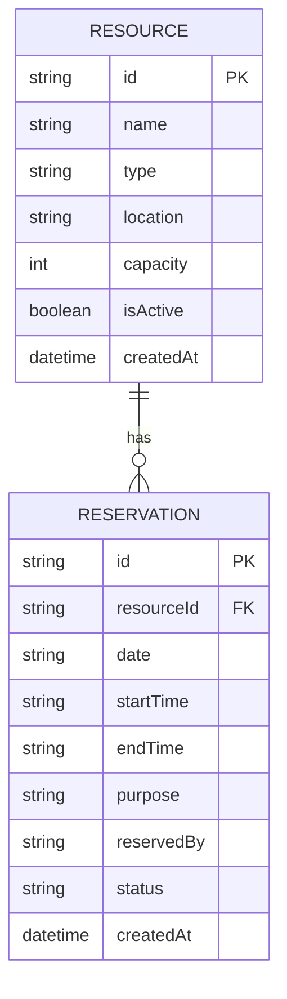

# Resource Reservation ER Diagram

A resource can have many reservations. Each reservation belongs to exactly one resource. The application checks the resource, date, and time range before creating a reservation to prevent overlapping bookings.
